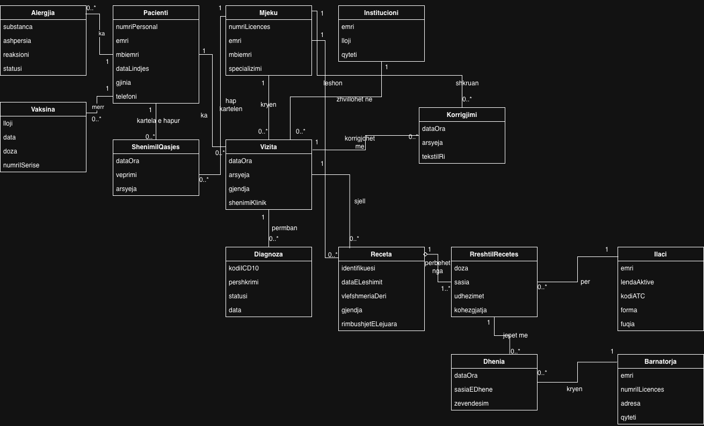

# Modeli konceptual

## Diagrami UML

## Përshkrimi i modelit konceptual

Modeli konceptual paraqet konceptet kryesore të sistemit eKartela dhe marrëdhëniet mes tyre. Ai përshkruan informacionin që sistemi ruan për pacientët, vizitat mjekësore, diagnozat, recet at dhe dhënien e barnave.

Pacienti identifikohet me numër personal dhe ka të dhëna personale si emri, mbiemri, data e lindjes, gjinia dhe telefoni. Një pacient mund të ketë shumë vizita, alergji, vaksina dhe shënime të qasjes në kartelë. Çdo vizitë, alergji, vaksinë ose shënim qasjeje i përket një pacienti.

Mjeku identifikohet me numrin e licencës dhe ka emër, mbiemër dhe specializim. Një mjek mund të kryejë shumë vizita, të lëshojë shumë receta, të shkruajë shumë korrigjime dhe të hapë shumë kartela. Çdo vizitë, recetë, korrigjim ose shënim qasjeje lidhet me një mjek.

Institucioni ruan emrin, llojin dhe qytetin. Një institucion mund të ketë shumë vizita, ndërsa secila vizitë zhvillohet në një institucion.

Vizita regjistron datën dhe orën, arsyen, gjendjen dhe shënimin klinik. Ajo kryhet për një pacient dhe nga një mjek. Një vizitë mund të ketë disa diagnoza dhe receta, si dhe mund të korrigjohet disa herë. Secila diagnozë, recetë ose korrigjim lidhet me një vizitë.

Diagnoza ruan kodin ICD-10, përshkrimin, statusin dhe datën. Një vizitë mund të ketë disa diagnoza, ndërsa secila diagnozë lidhet me një vizitë.

Alergjia ruan substancën, ashpërsinë, reaksionin dhe statusin. Vaksina ruan llojin, datën, dozën dhe numrin e serisë. Një pacient mund të ketë shumë alergji dhe vaksina; secila alergji dhe vaksinë lidhet me një pacient.

Receta përmban identifikuesin, datën e lëshimit, afatin e vlefshmërisë, gjendjen dhe numrin e rimbushjeve të lejuara. Receta lëshohet nga një mjek dhe lidhet me një vizitë. Lidhja me Rreshtin e Recetës paraqitet si agregim: një recetë përbëhet nga një ose më shumë rreshta dhe secili rresht i përket një recete.

Rreshti i Recetës ruan dozën, sasinë, udhëzimet dhe kohëzgjatjen. Çdo rresht i referohet një ilaçi, ndërsa i njëjti ilaç mund të shfaqet në shumë rreshta recetash. Një rresht mund të lidhet me disa ngjarje të dhënies së barit, për shembull në rast të dhënies së pjesshme ose rimbushjes.

Ilaçi përshkruhet me emrin, lëndën aktive, kodin ATC, formën dhe fuqinë. Ai mund të paraqitet në shumë rreshta recetash.

Dhënia ruan datën dhe orën, sasinë e dhënë dhe informacionin për zëvendësimin. Çdo dhënie lidhet me një rresht të recetës dhe kryhet nga një barnatore. Barnatorja ruan emrin, numrin e licencës, adresën dhe qytetin; një barnatore mund të kryejë shumë dhënie barnash.

Shënimi i Qasjes regjistron datën dhe orën, veprimin dhe arsyen e qasjes në kartelën e pacientit. Ai lidhet me pacientin dhe me mjekun që e ka hapur kartelën.

Korrigjimi ruan datën dhe orën, arsyen dhe tekstin e ri. Çdo korrigjim lidhet me vizitën përkatëse dhe me mjekun që e ka shkruar.